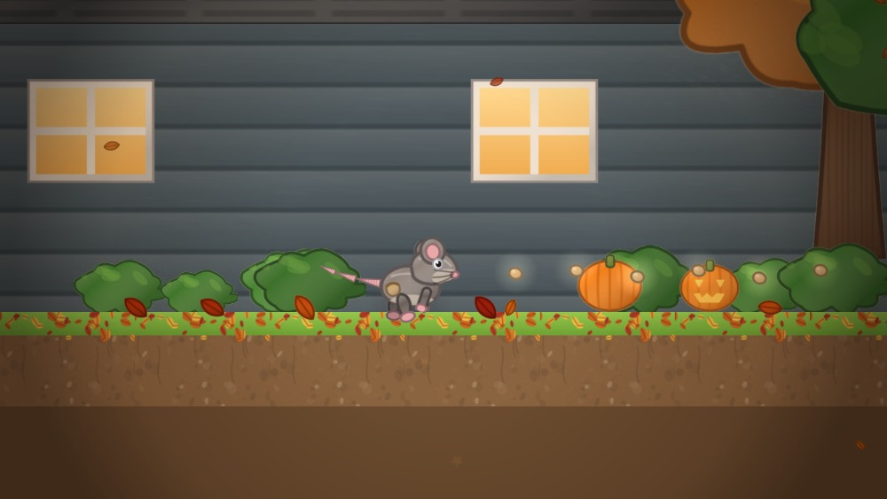
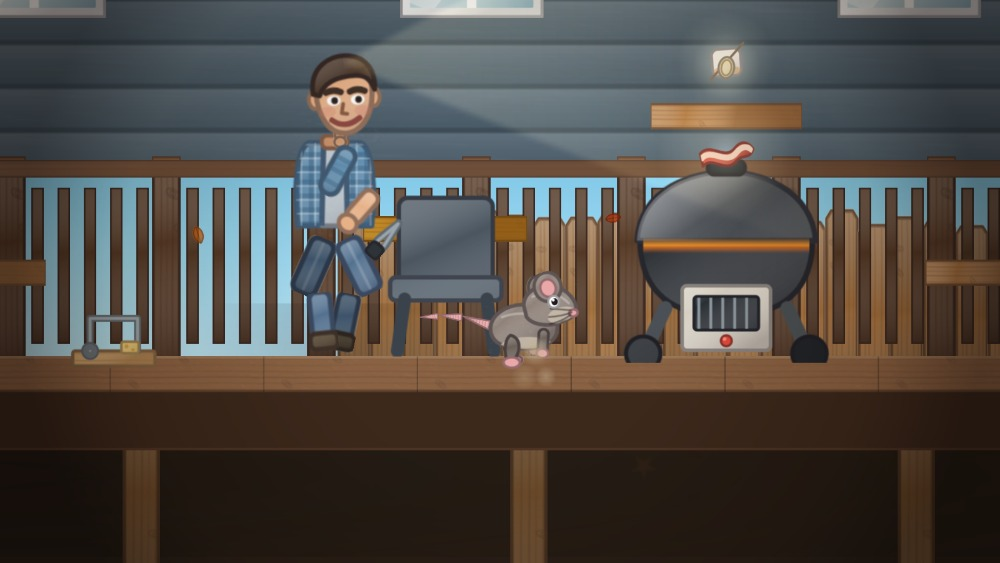
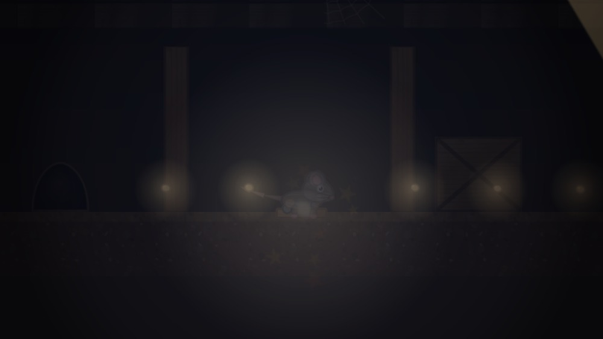
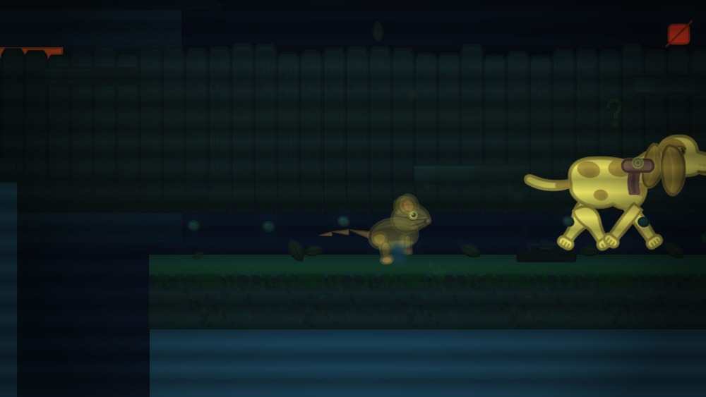
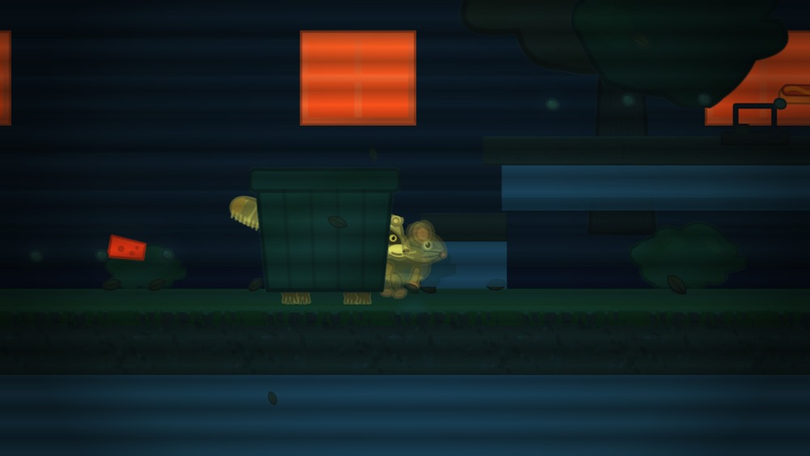

# Will's Backyard

A side-scrolling stealth-platformer about a rat raiding a backyard. Steal the
good food, evade Will and his dog Popcorn, and make it to the neighbour's hedge
before anybody notices.

The whole game is **one self-contained HTML file**. No server, no build step to
run it, no network access — open `dist/willsbackyard.html` and play.



## Play

Download [`dist/willsbackyard.html`](dist/willsbackyard.html) and open it in any
modern browser. That's it — the WebAssembly core is base64-embedded in the page
and every sprite is drawn procedurally at load.

Or play it online at <https://jtshaw.github.io/willsbackyard/>.

The published build is open to anyone. An optional password lock is still
available for private builds; see [Password protection](#password-protection).

| Input | Action |
| --- | --- |
| `←` `→` / `A` `D` | Run |
| `Space` / `↑` | Jump (hold for height) |
| `Shift` / `↓` | Sneak — slow, short, and quiet |
| `E` | Lift bait off a trap (crouch beside it first) |
| `↑` `↓` | Climb ladders, rope nets and the slide |
| `I` | Infrared camera (dark levels only) |
| `M` | Mute |
| `Esc` | Pause |

Gamepads work. On a phone, play in landscape — there's an on-screen d-pad.

## The five levels

| # | Level | The idea |
| --- | --- | --- |
| 1 | The Back Lawn | Dusk tutorial. Snap traps, a dozing dog, a flowerbed to cross. |
| 2 | Deck Feast | Will works the grill while you raid the table. He can't see under his own deck. |
| 3 | The Playhouse | Swings as pendulum platforms, a wave slide you can climb back up, a rope net, and the kids' snacks. |
| 4 | Under the Hutch | Pitch dark. Every trap is baited — lift the bait without springing it, and stay out of the flashlight. |
| 5 | Night Run | Everyone is awake. Run. |
| 6 | Trash Night | Will and Popcorn are asleep. The raccoons are not. |

<p align="center">
  
  
</p>

Noise is what gets you caught, not just line of sight. Sprinting is loud,
sneaking is nearly silent, and grabbing food off a plate makes a clatter that
carries. Each guard runs its own suspicion meter driven by what it can see and
what it can hear.

### The raccoons

On the last level the household is asleep and the yard belongs to a family of
raccoons. They sit inside the bins and crates and burst out when you get close.
They would rather rob you than eat you: contact costs you a piece of **loot**,
which can re-lock the hedge you were walking toward. Only if you are carrying
nothing do they bite instead.

This is what makes the thermal camera matter rather than decorate. A hiding
raccoon shows nothing but a pair of eyes in normal vision — but its body heat
reads straight through the bin it is sitting in, so infrared tells you which
containers are occupied before you walk into them.

### Infrared

The dark levels carry a thermal camera on `I`. Warm bodies, the grill and
fresh food glow; the world goes cold. It sees through the dark — but steel traps
sit at ambient temperature and nearly vanish, so it is a trade, not an upgrade.



*A raccoon breaking cover on Trash Night, seen in thermal:*



## How it is built

Rust owns the simulation and composition and hands JavaScript a flat list of
sprite quads each frame. JavaScript owns the GPU and the DOM. Nothing else.

```
rust/src/          the game: physics, AI, levels, scene composition
  levels.rs        all five levels, as data
  npc.rs           vision cones, suspicion, the chase
  puppet.rs        characters as articulated paper cut-outs
  draw.rs          the draw list, and the infrared colour remap
web/art/*.js       every sprite, drawn with Canvas2D at load time
web/atlas.js       MaxRects packer -> one 2048² texture
web/gl.js          WebGL sprite batcher
web/main.js        input, audio, HUD, menus
tools/             code generation, tests, offline renderer
```

A few deliberate choices:

**No `wasm-bindgen`.** The crate is a plain `cdylib` with C exports, so `cargo
build` is the entire toolchain. Rust writes a draw list into linear memory and
JS reads it back.

**No image assets.** Every sprite is drawn procedurally with Canvas2D at load
and packed into one atlas. The art style is Paper Mario by way of flat cut-out
shapes, inked edges, a single form-shadow gradient, and a little paper grain.
This is why the page is a few hundred KB and still has 122 distinct sprites.

**Sprite ids are generated.** `tools/gen_sprites.js` parses the art files and
emits `rust/src/sprites.rs`, so Rust and JS can never disagree about which
sprite is which, or how big it is.

## Password protection

A password on a static page is usually theatre: the check compares the typed
string to a constant, and the game sits in the same file, so anyone willing to
open View Source walks straight in.

This build does it properly. The game payload — the JS bundle and the
base64 wasm — is sealed with **AES-256-GCM** under a key derived from the
password with **PBKDF2-SHA256, 250,000 iterations**. The published page carries
only a random salt, an IV, and ciphertext. Without the password there is
nothing to run and nothing to read; a wrong guess fails the GCM tag check.

What it does *not* do is stop someone who has the password from decrypting the
payload once and passing it on. It is a lock on the door, not DRM.

The password is never committed. `build.sh` reads it from `$WB_PASSWORD` or a
gitignored `.password` file; with neither, it produces an unlocked build and
says so. `tools/test_lock.js` then checks the result actually protects
something — that no game code, level name or the password itself survives in
the page, that the real password opens it, and that near-miss passwords don't.

## Building

Requires Rust with the `wasm32-unknown-unknown` target, and Node for the
tooling.

```sh
rustup target add wasm32-unknown-unknown
npm install                          # @napi-rs/canvas, for the renderer and tests
echo -n 'your-password' > .password  # omit for an unlocked build
./build.sh                           # -> dist/willsbackyard.html, docs/index.html
```

`build.sh` will not produce a build unless the tests pass.

## Tests

The interesting problem in a game like this is that most bugs are *visual*, and
the usual tooling cannot see them. Four things cover it:

**`rust/src/reach_test.rs`** — derives the jump arc from the actual physics
constants and asserts every platform and every pickup is reachable. A single
unreachable loot item silently makes a level unwinnable: the hedge never opens
and the player is given no reason why. This found ten such spots.

**`tools/test_quad.js`** — drives the real `web/gl.js` through a stub WebGL
context and inspects the vertices it emits. Its main assertion is a continuity
check: `rot = 0` and `rot = 1e-7` must produce the same corners. `gl.js` has a
fast path for unrotated quads and a general path for the rest, and a sign error
in the general one flipped every *rotated* sprite upside down while leaving
static scenery perfectly correct.

**`tools/test_lock.js`** — confirms a protected build protects something: no
payload in the clear, the right password opens it, near-miss passwords do not.

**`tools/test_core.js`** — runs the wasm core headlessly for 90 simulated
seconds per level with synthetic input, watching for NaNs, wedged states and
draw-list blowouts.

There is also `tools/render.js`, which runs the real wasm core and rasterizes
actual frames to PNG with a headless canvas — useful for looking at the game
without a browser, though note it draws via Canvas2D rather than WebGL, so it
is not a substitute for `test_quad.js`.

```sh
node tools/render.js shots    # -> build/shot_*.png
node tools/sprites.js pop_head pop_ear   # inspect individual sprites
```

## Credits

Will and Popcorn are real, and so is the backyard. Any resemblance to an actual
rat problem is coincidental.
